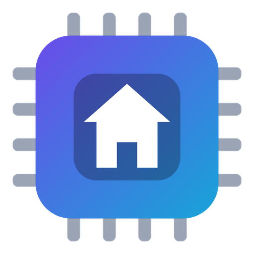

# Querencia

**Tu IA, en casa.** La *querencia* es el lugar donde uno se siente a salvo, al que siempre vuelve: aquí,
una IA que vive en tu ordenador, funciona sin internet y no comparte nada con nadie.

Asistente de IA **100 % local** para la terminal, al estilo de Claude Code o Gemini CLI. Ejecuta modelos
GGUF con [llama-cpp-python](https://github.com/abetlen/llama-cpp-python) o con [Ollama](https://ollama.com),
lee imágenes y PDFs, crea archivos y encadena respuestas largas sin perder el hilo.

Interfaz en español · Windows · Python 3.10+ (probado con 3.14).

## Qué hace
- **Chat en la terminal** con streaming en markdown, razonamiento plegable (`/think`), temas, sesiones
  (`/resume`, `/chat`) y memoria persistente (`LOCAL_AI.md`).
- **Ajuste automático de memoria**: estima VRAM y RAM según la arquitectura de cada modelo (`/mem`) y
  elige capas en GPU y contexto (`/auto`).
- **Visión con «lector»**: aunque tu modelo principal no tenga visión, un modelo de visión temporal
  transcribe imágenes y PDFs escaneados para él. El mmproj se empareja solo, por metadatos.
- **Archivos**: lo que escribe el modelo (HTML, código, documentos) se guarda solo (`/archivos`, `/open`,
  `/save`).
- **Modo proyecto** (`/proyecto <carpeta>` o `querencia -d <carpeta>`): el modelo trabaja directamente sobre
  una carpeta tuya, como un proyecto de Claude Code. Lee, busca, crea y edita archivos con ediciones pequeñas
  (BUSCAR/REEMPLAZAR). Cada cambio guarda una copia: `/deshacer` lo revierte y `/cambios diff` lo muestra.
- **Relevo automático**: si una respuesta no cabe en `/tokens`, el programa la divide en partes y las
  encadena. Cada continuación recibe solo el objetivo, el índice y las últimas líneas, nunca todo lo ya
  escrito, y al final se une todo.
- **Prompt-Zero** (`/zero`): crea páginas web desde un cuestionario, con un análisis de tokens y tareas
  que caben en cada respuesta.
- **Componentes web** (57, ver `/componentes` y `/componentes demo`): el modelo escribe etiquetas `.lai` y el
  programa genera `index.html`, CSS y JS ya probados. Gasta unas 4 veces menos tokens que escribir la web desde
  cero. Se usan solos en el chat cuando pides una página o plantilla, y también con `/plantilla <descripción>`.
- **Asistente de instalación** visual: analiza tu hardware, recomienda modelos por uso y nivel, y los
  descarga con reanudación. Antes de instalar muestra una **guía paso a paso** (pasos cortos que avanzan solos) que compara
  Claude, Gemini, Codex y la IA local. Tiene además una pestaña **Comparativa** (precios, equipo necesario,
  calculadora de amortización, beneficios, problemas y usos reales) y otra **Componentes** con demo en vivo.

## Instalación
1. Instala Python 3.10 o superior.
2. Ejecuta **`instalar-querencia.bat`**. Comprueba las dependencias y abre el asistente en el navegador. La
   ventana de consola se cierra sola al terminar (o al cerrar la página, salvo durante una descarga).
   También puedes instalar a mano:
   ```bash
   pip install -r requirements.txt
   pip install llama-cpp-python
   ```
   Con `pip install llama-cpp-python` se instala el motor para CPU, o una wheel precompilada para Vulkan o
   CUDA según tu GPU.
3. Coloca los modelos `.gguf` en `models/` (o descárgalos desde el asistente):
   ```
   models/
     llm/        modelos de texto
     vision/     modelos de visión (lector)
     mmproj/     proyectores de visión (mmproj-*.gguf)
     diffusion/  se ignora en el chat
   ```
   Si tienes Ollama abierto, sus modelos también aparecen en `/model`.
4. Comprueba que todo esté en orden:
   ```bash
   python local_ai.py --doctor
   ```

## Uso
Abre el acceso directo **Querencia** (lo crea el instalador, con su icono) o, desde una terminal:
```bash
querencia                                # abre el REPL (querencia.cmd o el acceso directo)
querencia -m Qwen3.6 --ctx 32k            # modelo y contexto para esta sesión
querencia -m Qwen3.6 "explica este error" -f log.txt   # pregunta directa
querencia --mem -m Qwen3.6                # cuánta VRAM/RAM necesita, sin cargarlo
querencia -d C:\proyectos\mi-web          # abrir una carpeta como proyecto
querencia --setup                         # asistente de instalación
```
`local-ai` sigue funcionando como alias del nombre anterior. Las opciones de la línea de comandos solo
valen para esa sesión. Para cambiar algo de forma permanente,
usa `/settings`.

### Comandos principales
| Comando | Para qué |
|---|---|
| `/model`, `/models` | elegir modelo (con tamaño, visión y memoria) · ver la tabla |
| `/ctx`, `/gpu`, `/kv`, `/auto` | contexto, capas en GPU, caché KV, ajuste automático |
| `/mem` | estimación de memoria antes de cargar |
| `/tokens`, `/temp`, `/top_p`, `/top_k`, `/min_p`, `/params` | longitud y muestreo |
| `/think on\|off\|show\|hide\|last` | razonamiento |
| `/file`, `/image`, `/pdf`, `@ruta` | adjuntar archivos |
| `/vision` | lector visual: modo, modelo, última transcripción |
| `/archivos`, `/open`, `/save`, `/copy`, `/export` | archivos creados y respuestas |
| `/proyecto [ruta\|cerrar\|recargar]` | trabajar sobre una carpeta (el modelo edita sus archivos) |
| `/cambios [diff]`, `/deshacer` | ver y revertir lo que cambió el modelo en el proyecto |
| `/plantilla <descripción>` | página o plantilla con componentes (HTML, CSS y JS generados) |
| `/zero`, `/componentes [chat auto\|on\|off]` | webs guiadas y catálogo de componentes |
| `/resume`, `/chat`, `/compact`, `/clear` | sesiones y contexto |
| `/memory`, `/system` | instrucciones persistentes y prompt de sistema |
| `/settings`, `/modo`, `/theme` | ajustes, perfiles de uso, colores |
| `/stats`, `/doctor`, `/debug` | métricas y diagnóstico |

Atajos: **Shift+Enter** nueva línea · **Esc** cancelar · **t** mostrar el razonamiento en vivo ·
**?** lista de atajos · **/** autocompleta comandos.

### Relevo automático
Está activo por defecto. Cada respuesta reserva un 15 % de `/tokens` (configurable entre el 10 y el 25 %
en `/settings`) para dejar un índice de lo que falta. Después:
- Si el índice es coherente, el programa pide cada parte pendiente por separado. Con Ollama, las partes
  independientes van en paralelo.
- Si no lo es, continúa desde las últimas líneas.

En ambos casos, el prompt de cada relevo tiene un tamaño constante (~600 tokens) y el resultado final se
une en orden. El registro de cada cadena se guarda en `~/.local_ai/relevos/`.

### Modo proyecto
```text
/proyecto C:\proyectos\mi-tienda
> cambia el título a «Tienda Aurora» y haz que el botón de comprar muestre una alerta
```
- **Contexto:** el modelo recibe la estructura de la carpeta, sin `node_modules`, `.git`, compilados ni lo
  que ignore tu `.gitignore`. En proyectos pequeños, el programa le adjunta además el contenido de los
  archivos nuevos o cambiados desde la última vez, así no tiene que pedirlos.
- **Herramientas de texto:** las entiende cualquier modelo, no hace falta function calling. El programa
  devuelve los resultados y el modelo sigue, hasta `project_rounds` rondas por mensaje (4 por defecto).
  - `<leer ruta="x"/>` lee un archivo, `<listar ruta="x"/>` lista una carpeta y `<grep>texto</grep>`
    busca en todo el proyecto.
  - `<editar ruta="x">` con pares BUSCAR/REEMPLAZAR cambia solo lo necesario.
  - Los bloques ```lenguaje ruta``` crean archivos nuevos.
- **Tolerancia:** también acepta pares BUSCAR/REEMPLAZAR sin ruta (deduce el archivo por su contenido) y
  llamadas JSON tipo `read_file` o `str_replace`. Si el modelo anuncia un cambio sin hacerlo, se lo
  recuerda.
- **Seguridad:**
  - Nada se escribe fuera de la carpeta.
  - Se rechaza reescribir un archivo con «… resto igual».
  - Un bloque cortado no sobrescribe un archivo existente.
  - Las copias se guardan en `~/.local_ai/respaldos/`.
- **Instrucciones del proyecto:** pon un `LOCAL_AI.md` en la carpeta (`/memory edit proyecto`).

### Componentes para plantillas
`/plantilla landing de una barbería con servicios, equipo, reservas y mapa` hace que el modelo escriba solo
`pagina.lai` y el programa genere la web. Además de los clásicos (navbar, hero, cards, pricing, faq,
gallery, products + carrito, table, gantt, crud…) hay:

| Tipo | Componentes |
|---|---|
| Estructura | `banner`, `float` (WhatsApp, volver arriba, modo oscuro), `cookies`, `modal` |
| Contenido | `features`, `team`, `logos`, `tabs`, `carousel`, `beforeafter`, `video`, `map` |
| Negocio | `menu` (carta), `hours` («abierto ahora»), `compare`, `invoice` (presupuesto imprimible), `progress` (metas), `countdown`, `newsletter`, `pricing` con interruptor mensual/anual |
| Formularios | `form`, `wizard` (por pasos), `login` (simulado), `quiz`, `poll`, `calculator` (fórmula propia), `chatbot` (preguntas frecuentes) |
| Datos y apps | `chart` (barras, línea, tarta, donut), `kanban`, `todo`, `calendar`, `expenses` (gastos) |

- **En el chat**, los componentes se activan solos cuando pides una página (`/componentes chat auto`).
  Solo se documentan en detalle los básicos, los que encajan con tu petición y los que ya usa la página;
  del resto va solo el nombre. Son ≈2.500 tokens en lugar de ≈5.000.
- **`/componentes demo`** abre una página de ejemplo con 36 componentes. Su `pagina.lai` sirve de chuleta.
- **`/zero`** tiene 12 tipos de web (restaurante, negocio con citas, evento, curso, ONG, app de
  productividad…). Además, ofrece extras opcionales (WhatsApp, chat, cookies, condiciones, presupuesto) y un
  login simulado sin servidor.

## Dónde se guardan las cosas
Todo el estado vive en `~/.local_ai/` (fuera de este repositorio):

| Ruta | Contenido |
|---|---|
| `config.json` | ajustes |
| `sessions/` | conversaciones guardadas y autoguardadas |
| `archivos/<sesión>/` | archivos creados por el modelo |
| `proyectos/` | proyectos de `/zero` |
| `transcripciones/` | caché del lector visual |
| `relevos/` | registros del relevo |
| `respaldos/<sesión>/` | copias de los archivos del proyecto antes de cada cambio del modelo |
| `crash.log` | errores no controlados |

## Problemas frecuentes
- **GPU AMD o Intel**: se detecta por el registro de Windows y la VRAM libre por los contadores del
  sistema. Ojo: `pip install llama-cpp-python` instala la versión solo CPU; `/doctor` explica cómo
  conseguir la de Vulkan (o usar Ollama).
- **Va lento o falta VRAM**: usa `/mem` y `/auto`. Un juego o un fondo animado en la GPU puede reducir
  mucho la velocidad.
- **El modelo no ve imágenes**: `/doctor` indica qué mmproj falta y cuál descargar. El programa nunca
  descarga nada sin tu permiso.
- **Una respuesta se corta**: el relevo la continúa solo. Si lo has desactivado, sube `/tokens`.

## Identidad
- **Nombre:** Querencia · **lema:** «tu IA, en casa» · **colores:** violeta `#7c3aed` → cian `#06b6d4`.
- **Icono:** un chip con una casa (`localai/assets/querencia.ico`, `.png` y `.svg`). Es el mismo en los
  accesos directos, la barra del navegador del asistente y la guía.
- **Accesos directos:** los `.bat` no admiten icono propio, así que el instalador crea `Querencia.lnk` e
  `Instalar Querencia.lnk` con el icono. Para crearlos también en el escritorio:
  `powershell -ExecutionPolicy Bypass -File localai\assets\accesos.ps1 -Escritorio`.
- **Nombres internos que no cambian** (para no perder datos ni romper rutas): el paquete `localai/`, la
  entrada `local_ai.py` y la carpeta de datos `~/.local_ai/`.

## Estructura del código
El paquete `localai/` contiene la aplicación, los motores, la memoria, la visión, el relevo, el
asistente y los componentes web. El detalle de cada módulo está en [CLAUDE.md](CLAUDE.md), y los
diagnósticos e historial de decisiones en [LEEME.md](LEEME.md).
